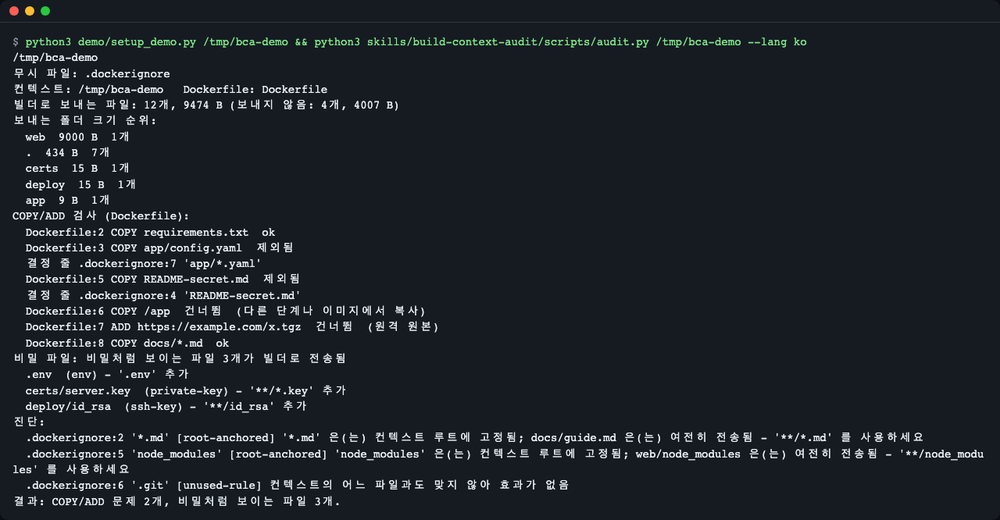
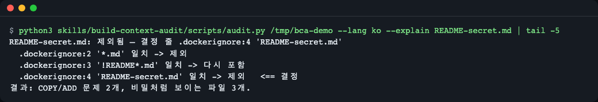
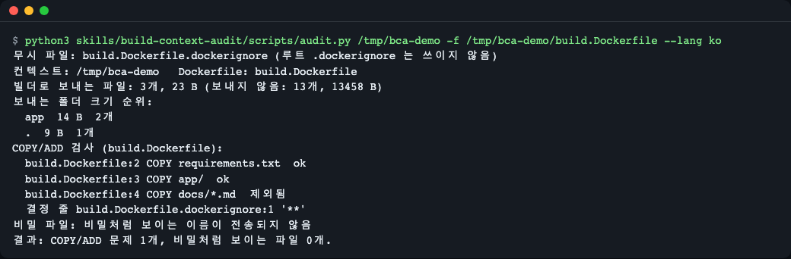
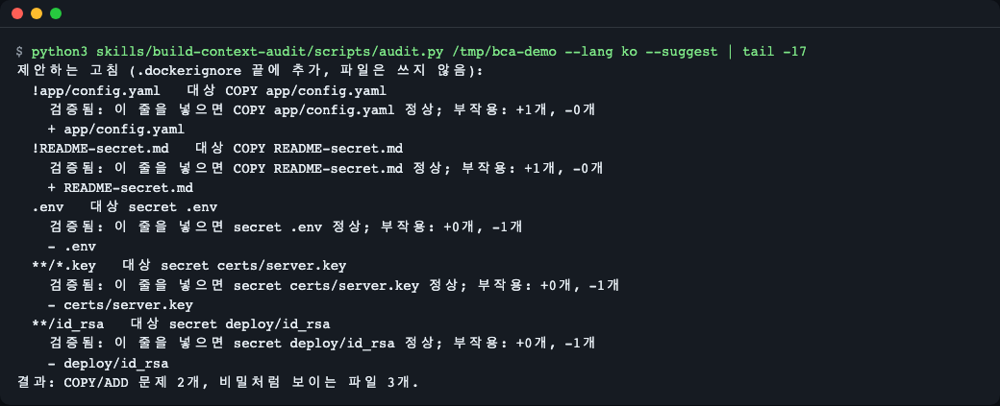
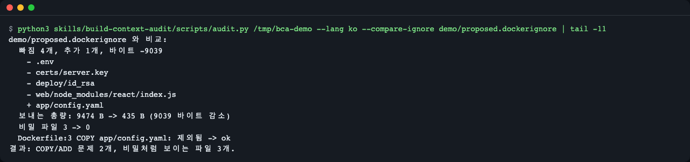
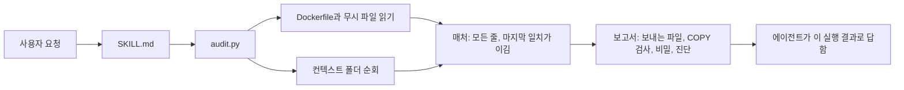

# build-context-audit

[English](README.md) | **한국어**

`docker build` 를 돌리기 전에, 빌드 컨텍스트가 실제로 보내는 파일, 파일마다 결정한 `.dockerignore` 줄, 실패할 `COPY`/`ADD` 원본, 섞여 들어가는 비밀처럼 보이는 파일을 정확히 계산해 주는 에이전트 스킬입니다. 표준 라이브러리만 쓰는 Python 스크립트라서 Docker 데몬이 필요 없습니다.


*데모 복사본에 명령 하나: 12개 파일 전송, 결정 줄이 붙은 실패 COPY 2건, 비밀처럼 보이는 파일 3개, 진단 3건.*

## 무엇을 하나

- **무시 규칙을 정확히 재현**합니다. `.dockerignore` 는 `.gitignore` 와 다릅니다. 모든 패턴은 컨텍스트 루트에 고정되고, 마지막으로 맞는 줄이 이기며, `!` 예외는 뒤 줄에서 다시 취소될 수 있고, `**` 를 지원하며, `<Dockerfile 이름>.dockerignore` 가 `.dockerignore` 를 통째로 대체합니다. 대소문자를 구분합니다.
- 파일마다 **결정한 줄을 알려 줍니다**(`--explain PATH`). 보내는 파일 수·바이트와 큰 폴더 순위도 냅니다.
- **`COPY`/`ADD` 교차 검사**: 줄 이어쓰기, JSON 형식, 옵션, 와일드카드를 읽고, `--from`·URL·heredoc 원본은 건너뜁니다.
- **비밀처럼 보이는 파일**(`.env`, 개인 키, SSH 키)을 파일 이름만으로 찾습니다. 파일 내용은 읽지 않습니다.
- **고치기 전에 검증**: `--suggest` 는 덧붙일 최소 줄을 제안하고 전체를 다시 계산합니다. `--compare-ignore` 는 제안한 무시 파일이 파일을 늘리고 줄이는 모습을 보여 줍니다.
- 출력은 text·Markdown·JSON, 영어·한국어. `--out` 을 주지 않으면 아무것도 쓰지 않습니다.

## 설치

Python 3.10 이상이 필요합니다(표준 라이브러리만 사용). 없으면 패키지 관리자로 설치하세요. 예: `brew install python`(macOS), `sudo apt-get install -y python3`(Debian/Ubuntu).

**Claude Code**

```
/plugin marketplace add LeeGyeongPil/build-context-audit
/plugin install build-context-audit@build-context-audit-skill
```

**다른 에이전트(Agent Skills 표준)** - `skills/build-context-audit` 폴더를 에이전트의 스킬 폴더에 복사합니다(예: 프로젝트의 `.agents/skills/`).

**에이전트 없이** - 레포를 받아 스크립트를 직접 실행합니다.

```
git clone https://github.com/LeeGyeongPil/build-context-audit
cd build-context-audit
python3 skills/build-context-audit/scripts/audit.py CONTEXT --lang ko
```

## 사용법

에이전트에게 평소 말투로 요청하세요. 스킬 평가 세트가 확인하는 요청들입니다.

- `docker build fails with "COPY failed: file not found in build context or excluded by .dockerignore" - why?` (COPY 가 빌드 컨텍스트에 없거나 .dockerignore 로 제외됐다며 실패하는 이유)
- `Which line in .dockerignore is excluding src/config.yaml?` (.dockerignore 의 어느 줄이 src/config.yaml 을 제외하나)
- 한국어도 됩니다: `도커 빌드할 때 .dockerignore 때문에 어떤 파일이 빠지는지 확인해줘.`

레포 루트에서 직접 실행해도 됩니다. `CONTEXT` 는 `docker build` 에 주는 폴더, `-f` 는 `docker build -f` 와 같은 값입니다. 첫 명령은 `demo/context` 를 `/tmp/bca-demo` 로 복사하고 자리표시 `.env` 를 더한 뒤(레포는 `.env` 를 추적하지 않습니다) 그 복사본을 검사합니다.

```
python3 demo/setup_demo.py /tmp/bca-demo && python3 skills/build-context-audit/scripts/audit.py /tmp/bca-demo --lang ko
```

`setup_demo.py` 는 만든 폴더 경로를 출력합니다. 새 경로, 빈 폴더, 이전 데모 복사본(데모 파일과 `.env` 만 있음)에만 쓰므로 같은 줄을 반복 실행할 수 있습니다. 그 밖의 폴더·파일·링크는 건드리지 않고 종료 코드 2 로 끝납니다(`--lang ko` 를 주면 한국어 메시지).

데모 컨텍스트의 `.dockerignore` 는 다음과 같습니다.

```
# comment
*.md
!README*.md
README-secret.md
node_modules
.git
app/*.yaml
```

출력 읽는 법(위 스크린샷 참고):

- `무시 파일:` 은 쓰인 파일 이름입니다. `(루트 .dockerignore 는 쓰이지 않음)` 은 Dockerfile 별 파일이 대체했다는 뜻입니다.
- `빌더로 보내는 파일` 과 `보내는 폴더 크기 순위` 가 합계입니다. 여기서는 5번 줄 `node_modules` 가 루트에서만 맞기 때문에 `web/node_modules` 가 9474 B 중 9000 B 를 차지합니다.
- `COPY/ADD 검사` 는 `ok`, `제외됨`(다음 줄에 `결정 줄 파일:줄 '패턴'`), `없음`, `건너뜀`, `확인 못 함` 으로 표시합니다.
- `비밀 파일` 은 경로와 그것을 없앨 줄을 보여 줍니다.
- `진단`: `root-anchored`, `unused-rule`, `shadowed-exception`, `suffix-match`, `inline-comment`, `bang-class`, `escape-directive`.
- 종료 코드: 0 문제 없음, 1 COPY/ADD 실패 또는 비밀 파일(`--fail-on warning` 이면 진단도), 2 입력 문제, 3 무시 파일 문법 오류. 데모는 1 로 끝납니다.

아래 명령들은 같은 `/tmp/bca-demo` 를 씁니다. 명령 끝에 `| tail -N` 이 있으면 잘린 윗부분은 위와 같은 보고서이고, `tail` 은 새로 붙는 절과 `결과:` 줄만 남깁니다(파이프 때문에 종료 코드는 보이지 않습니다).

**이 파일은 왜 제외됐나?**

```
python3 skills/build-context-audit/scripts/audit.py /tmp/bca-demo --lang ko --explain README-secret.md | tail -5
```


*`--explain` 은 맞는 줄을 순서대로 모두 나열하고 결정한 줄을 표시합니다. 2번 줄이 제외, 3번 줄이 다시 포함, 4번 줄이 다시 제외합니다.*

**`-f` 는 어떤 무시 파일을 읽나?**

```
python3 skills/build-context-audit/scripts/audit.py /tmp/bca-demo -f /tmp/bca-demo/build.Dockerfile --lang ko
```


*`build.Dockerfile.dockerignore` 가 이기므로 3개 파일만 전송되고, `COPY docs/*.md` 는 그 파일 1번 줄(`**`)에서 실패합니다.*

**가장 작은 고침은?** 아무것도 쓰지 않으며, 고침마다 규칙 복사본으로 다시 계산합니다.

```
python3 skills/build-context-audit/scripts/audit.py /tmp/bca-demo --lang ko --suggest | tail -17
```


*`!app/config.yaml` 이 실패한 COPY 를 고치고 파일을 정확히 1개 들여옵니다(`+1개, -0개`). 비밀 파일 고침 3줄은 각각 파일 1개를 뺍니다.*

**무시 파일을 통째로 바꾸면?**

```
python3 skills/build-context-audit/scripts/audit.py /tmp/bca-demo --lang ko --compare-ignore demo/proposed.dockerignore | tail -11
```


*파일 4개가 빠지고(그중 3개는 비밀처럼 보이는 파일) 1개가 들어오며, 보내는 총량이 9474 B 에서 435 B 로 줄고, `app/config.yaml` 의 COPY 는 `제외됨` 에서 `ok` 로 바뀝니다.*

그 밖의 옵션: `--list excluded|included|all`, `--max-list N`, `--top N`, `--format text|md|json`, `--out FILE`, `--ignore-file FILE`(예: `.containerignore`), `--fail-on error|warning|never`.

- 언어: `--lang en|ko` > `BUILD_CONTEXT_AUDIT_LANG` > `LC_ALL` / `LC_MESSAGES` / `LANG` 순서로 정하고, 한국어가 아니면 영어입니다. JSON 출력은 언어와 무관하게 같습니다.
- JSON(--format json) 최상위 키: `context`, `dockerfile`, `ignore_file`, `ignore_file_reason`, `totals`, `top_dirs`, `copy_checks`, `secrets`, `hints`, `explain`, `suggestions`, `compare`, `notes`, `summary`.
- `setup_demo.py` 없이 `demo/context` 를 바로 검사하면 추적되는 폴더에 `.env` 가 없어서 파일 11개, 9460 B, 비밀처럼 보이는 파일 2개가 나옵니다.

## 검증된 동작

<!-- skill-eval:start -->
| 확인 | 결과 |
|---|---|
| 필요할 때 불림 | 13/13 |
| 필요 없을 때 안 불림 | 12/12 |
| 스킬로 푼 작업 | 6/6 |
| 스킬 없이 푼 작업(기준선) | 0/6 |
| 평균 점수 차이(Δ) | +0.49 |
| 가짜 스크립트를 잡아낸 비율 | 6/6 |
| Codex CLI | 미검증 |

Claude Code 2.1.322 · sonnet · 케이스마다 3회 · 2026-11-16 측정 · codex-cli 0.154.0
<!-- skill-eval:end -->

숫자 읽는 법: 작업 채점에는 스크립트가 출력한 보고서 줄을 확인하는 그레이더가 들어 있어, 스킬 없는 기준선은 구조적으로 만점을 받을 수 없습니다. 그래서 "스킬 있음"과 "스킬 없음"의 차이 중 일부는 틀린 답이 아니라 이 채점 구조에서 옵니다. 실측 검증은 Claude Code 에서 했습니다. 표준 SKILL.md 형식을 읽는 다른 에이전트의 결과는 검증됨으로 표시하지 않습니다.

## 동작 원리



- 요청이 스킬 설명과 맞으면 에이전트가 `SKILL.md` 를 읽고, 규칙을 기억으로 추론하는 대신 `scripts/audit.py` 를 실행합니다.
- 스크립트는 Dockerfile 과 무시 파일을 읽고 폴더를 순회합니다. 파일마다 모든 줄을 끝까지 돌려 맞은 줄과 결정한 줄을 기록합니다.
- `--suggest` 와 `--compare-ignore` 는 제안한 줄로 새 매처를 만들어 폴더 전체를 다시 판정합니다.
- 매처는 레퍼런스 Docker 의미를 새로 구현한 것입니다. `fnmatch` 가 아니라 문자열 비교와 `re` 만 써서 플랫폼에 따라 결과가 달라지지 않습니다.
- 범위: 지정한 폴더, Dockerfile, 무시 파일만 읽습니다. 네트워크 호출이 없고, 읽기 외 권한이 필요 없으며, 파일 내용은 읽지 않습니다. 비밀은 이름으로만 찾습니다.

## 언제 쓰나

- 잘 맞는 상황: `COPY` 가 "not found" 나 "excluded" 로 실패할 때, 빌드가 예상보다 훨씬 많이 올릴 때, `.env` 나 키 파일이 이미지에 들어가는지 알고 싶을 때.
- 다루지 않는 것: 이미지 레이어·크기, 멀티 스테이지 빌드, `.gitignore`, `.npmignore`, Compose 설정, 빌드 비밀 마운트, 원격 컨텍스트.
- 그런 경우는 [빌드 컨텍스트](https://docs.docker.com/build/concepts/context/)와 [`.dockerignore`](https://docs.docker.com/build/concepts/context/#dockerignore-files) 공식 문서를 보세요.

## 대안

모두 2026-11-15 확인. 검사를 어디서 돌릴지에 맞춰 고르세요.

| 도구 | 무엇인가 | 그쪽이 더 맞는 경우 |
|---|---|---|
| [`docker build --check` 의 CopyIgnoredFile 규칙](https://docs.docker.com/reference/build-checks/copy-ignored-file/) | Docker 내장. `COPY` 원본이 `.dockerignore` 로 제외되면 경고합니다. 빌더가 필요하고, 결정 줄·합계·비밀 같은 이름은 알려 주지 않습니다. | 이미 `docker build` 를 돌리고 있고 COPY 경고만 있으면 될 때 |
| [Dtoxic28/dockerignore-audit](https://github.com/Dtoxic28/dockerignore-audit) | Node.js 22.1+ CLI 와 GitHub Action: explain, COPY/ADD 검사, 민감 파일 이름, 크기 임계값, Dockerfile 별 무시 파일, 쓰이지 않는 규칙, SARIF, baseline, Compose | CI 게이트, 코드 스캐닝(SARIF), 허용한 발견을 baseline 으로 관리, Compose 프로젝트 |
| [luoowei/dockctx](https://github.com/luoowei/dockctx) | Node CLI: 포함·제외 수와 바이트, 제외된 COPY/ADD 원본, 비밀 같은 경로, 크기 예산, Markdown/JSON. Dockerfile 별 무시 파일은 로드맵에 있습니다. | Node 도구 모음 안에서 크기 예산을 검사할 때 |
| [docker-context-guard](https://github.com/wc1905605162-sketch/docker-context-guard) | 의존성 없는 Python CLI·GitHub Action·pre-commit 훅, 위험 규칙 DCG001-DCG005. README 스스로 매칭을 일부러 작게 만들었다고 밝힙니다. | 커밋 전 가벼운 가드 |

이 스킬은 에이전트가 실패한 빌드를 보거나 `.dockerignore` 를 고치는 순간을 위한 것입니다. `python3` 하나로 돌고, 판정마다 결정 줄을 알려 주며, 고침 줄(`--suggest`)이나 새 무시 파일 전체(`--compare-ignore`)를 바꾸기 전에 검증합니다.

## 개발

```
uv sync && uv run pytest -q
```

테스트는 Python 3.10 이상에서 돕니다. `tests/test_docker_oracle.py` 는 실제 `docker build` 컨텍스트와 대조하며 Docker 데몬이 없으면 건너뜁니다. `evals/` 평가 세트는 발동 13개, 비발동 12개, 작업 6개이고 `tests/test_evals_shape.py` 가 구성을 검사합니다.

## 라이선스

MIT
