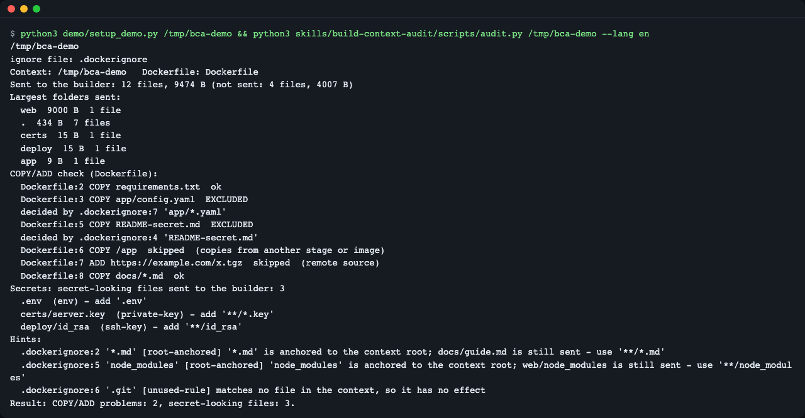
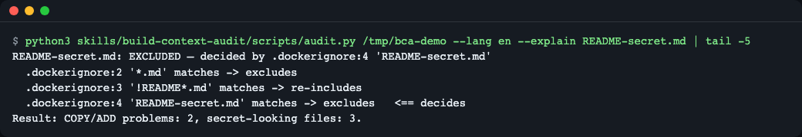
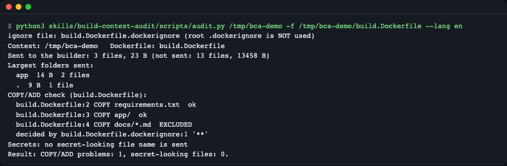
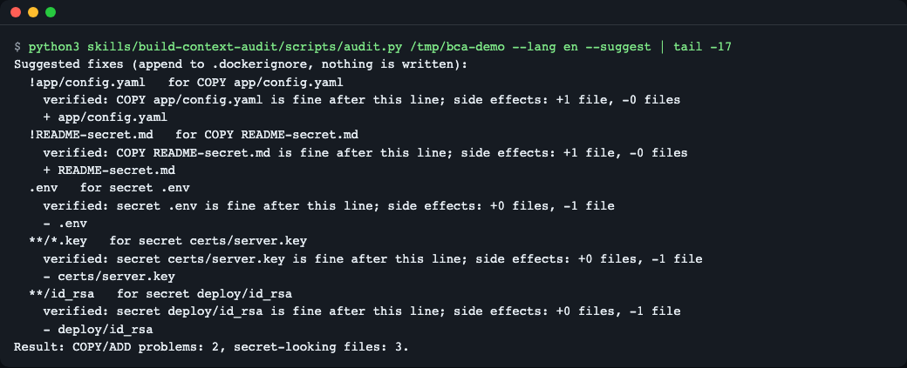
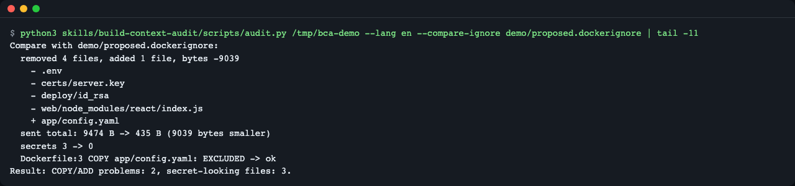
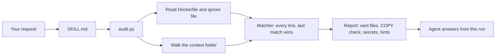

# build-context-audit

**English** | [한국어](README.ko.md)

An agent skill that, before `docker build` runs, computes exactly which files the build context will send, which `.dockerignore` line decided each one, which `COPY`/`ADD` sources will fail, and which secret-looking files slip in. It is a bundled standard-library Python script, so no Docker daemon is needed.


*One command on the demo copy: 12 files sent, two failing COPY lines with the deciding ignore line, three secret-looking files, and three hints.*

## What it does

- **Reproduces the ignore rules exactly**. `.dockerignore` is not `.gitignore`: every pattern is anchored to the context root, the last matching line wins, `!` exceptions can be undone by a later line, `**` works, and `<Dockerfile name>.dockerignore` replaces `.dockerignore` completely. Matching is case-sensitive.
- **Names the deciding line** for each file (`--explain PATH`), then totals the files and bytes sent and the largest folders.
- **Cross-checks `COPY`/`ADD`**: line continuations, JSON form, flags and wildcards are read; `--from`, URL and heredoc sources are skipped.
- **Flags secret-looking files** (`.env`, private keys, SSH keys) by file name only. File contents are never read.
- **Verifies fixes before you edit**: `--suggest` proposes the smallest line to append and re-computes the whole audit; `--compare-ignore` shows what a proposed ignore file would add or remove.
- Output in text, Markdown or JSON, in English or Korean. Nothing is ever written unless you pass `--out`.

## Install

Requires Python 3.10 or newer (standard library only). Install Python with your package manager if needed, for example `brew install python` (macOS) or `sudo apt-get install -y python3` (Debian/Ubuntu).

**Claude Code**

```
/plugin marketplace add LeeGyeongPil/build-context-audit
/plugin install build-context-audit@build-context-audit-skill
```

**Other agents (Agent Skills standard)** - copy `skills/build-context-audit` into the agent's skills folder (for example `.agents/skills/` in a project).

**Without an agent** - clone the repo and call the script directly:

```
git clone https://github.com/LeeGyeongPil/build-context-audit
cd build-context-audit
python3 skills/build-context-audit/scripts/audit.py CONTEXT --lang en
```

## Use it

Ask your agent in plain words. These requests are the kind the skill's evaluation set checks:

- `docker build fails with "COPY failed: file not found in build context or excluded by .dockerignore" - why?`
- `Which line in .dockerignore is excluding src/config.yaml?`
- Korean works too: `도커 빌드할 때 .dockerignore 때문에 어떤 파일이 빠지는지 확인해줘.` (Check which files are dropped by .dockerignore when building.)

Or run it yourself from the repo root. `CONTEXT` is the folder you give to `docker build`, `-f` is the same value as `docker build -f`. The first command copies `demo/context` to `/tmp/bca-demo`, adds a placeholder `.env` (the repo does not track one), and audits the copy:

```
python3 demo/setup_demo.py /tmp/bca-demo && python3 skills/build-context-audit/scripts/audit.py /tmp/bca-demo --lang en
```

`setup_demo.py` prints the folder it made. It only writes to a new path, an empty folder, or an earlier demo copy (nothing but demo files and `.env` inside), so you can re-run the line. Any other folder, file or link is left untouched and it exits with 2 (`--lang ko` for Korean messages).

The demo context has this `.dockerignore`:

```
# comment
*.md
!README*.md
README-secret.md
node_modules
.git
app/*.yaml
```

Reading the output (see the screenshot above):

- `ignore file:` names the file in use. `(root .dockerignore is NOT used)` means a Dockerfile-specific file replaced it.
- `Sent to the builder` and `Largest folders sent` give totals. Here `web/node_modules` is 9000 of 9474 bytes, because `node_modules` on line 5 only matches at the context root.
- `COPY/ADD check` shows `ok`, `EXCLUDED` (with the deciding `file:line 'pattern'`), `MISSING`, `skipped` or `unchecked`.
- `Secrets` lists the paths and the line that would remove each one.
- `Hints`: `root-anchored`, `unused-rule`, `shadowed-exception`, `suffix-match`, `inline-comment`, `bang-class`, `escape-directive`.
- Exit code: 0 nothing found, 1 a COPY/ADD failure or secret (`--fail-on warning` adds hints), 2 input problem, 3 ignore-file syntax error. The demo exits with 1.

The next commands use the same `/tmp/bca-demo`. Where a command ends in `| tail -N`, the cut-off top part is the same report as above; `tail` keeps only the new section and the `Result:` line (and the pipe hides the exit code).

**Why was this file excluded?**

```
python3 skills/build-context-audit/scripts/audit.py /tmp/bca-demo --lang en --explain README-secret.md | tail -5
```


*`--explain` lists every matching line in order and marks the one that decides: line 2 excludes, line 3 re-includes, line 4 excludes again.*

**Which ignore file does `-f` read?**

```
python3 skills/build-context-audit/scripts/audit.py /tmp/bca-demo -f /tmp/bca-demo/build.Dockerfile --lang en
```


*`build.Dockerfile.dockerignore` wins, so only 3 files are sent and `COPY docs/*.md` fails on its line 1 (`**`).*

**What is the smallest fix?** Nothing is written; each fix is re-computed on a copy of the rules.

```
python3 skills/build-context-audit/scripts/audit.py /tmp/bca-demo --lang en --suggest | tail -17
```


*`!app/config.yaml` fixes the failing COPY and brings in exactly one file (`+1 file, -0 files`); the three secret lines each remove one file.*

**What if I replace the ignore file?**

```
python3 skills/build-context-audit/scripts/audit.py /tmp/bca-demo --lang en --compare-ignore demo/proposed.dockerignore | tail -11
```


*Four files drop out (three of them secret-looking), one comes in, the total goes from 9474 B to 435 B, and the COPY of `app/config.yaml` goes from EXCLUDED to ok.*

Other options: `--list excluded|included|all`, `--max-list N`, `--top N`, `--format text|md|json`, `--out FILE`, `--ignore-file FILE` (for example `.containerignore`), `--fail-on error|warning|never`.

- Language: `--lang en|ko` > `BUILD_CONTEXT_AUDIT_LANG` > `LC_ALL` / `LC_MESSAGES` / `LANG`; anything that is not Korean gives English. JSON output is the same in both languages.
- JSON (--format json) top-level keys: `context`, `dockerfile`, `ignore_file`, `ignore_file_reason`, `totals`, `top_dirs`, `copy_checks`, `secrets`, `hints`, `explain`, `suggestions`, `compare`, `notes`, `summary`.
- Running on `demo/context` directly (without `setup_demo.py`) gives 11 files, 9460 B and 2 secret-looking files, because the tracked folder has no `.env`.

## Verified behavior

<!-- skill-eval:start -->
| Check | Result |
|---|---|
| Triggers when it should | 13/13 |
| Stays quiet when it should not | 12/12 |
| Tasks solved with the skill | 6/6 |
| Tasks solved without it (baseline) | 0/6 |
| Mean score gain (Δ) | +0.49 |
| Tasks that catch a broken script | 6/6 |
| Codex CLI | not verified |

Measured 2026-11-16 with Claude Code 2.1.322 · sonnet · 3 runs per case · codex-cli 0.154.0
<!-- skill-eval:end -->

How to read these numbers: the task grading includes graders that look for report lines printed by the script. A baseline run without the skill cannot print those lines, so it cannot get full marks by design; part of the gap between "with skill" and "without skill" comes from that, not only from wrong answers. The measurement was verified on Claude Code. Results from other agents that read the standard SKILL.md format are not marked as verified.

## How it works



- The agent loads `SKILL.md` when a request matches its description, then runs `scripts/audit.py` instead of reasoning about the rules from memory.
- The script reads the Dockerfile and the ignore file, then walks the folder. For each file it runs all lines to the end and records which lines matched and which one decided.
- `--suggest` and `--compare-ignore` build a new matcher with the proposed lines and judge the whole folder again.
- The matcher is a clean-room implementation of the reference Docker semantics. It uses string comparison and `re`, not `fnmatch`, so results do not depend on the platform.
- Scope: it reads only the folder you name, the Dockerfile and the ignore file. It makes no network calls, needs no permissions beyond reading, and never reads file contents. Secrets are found by name only.

## When to use it

- Good fit: a `COPY` fails with "not found" or "excluded", the build uploads far more than expected, or you want to know whether `.env` or key files end up in the image.
- Not covered: image layers and size, multi-stage builds, `.gitignore`, `.npmignore`, Compose settings, build secret mounts, remote contexts.
- For those, see the official documents on [build context](https://docs.docker.com/build/concepts/context/) and [`.dockerignore`](https://docs.docker.com/build/concepts/context/#dockerignore-files).

## Alternatives

All checked 2026-11-15. Pick the one that fits where the check runs.

| Tool | What it is | When it fits better |
|---|---|---|
| [`docker build --check`, rule CopyIgnoredFile](https://docs.docker.com/reference/build-checks/copy-ignored-file/) | Built into Docker. Warns when a `COPY` source is excluded by `.dockerignore`. Needs a builder; does not name the deciding line, totals or secret-looking names. | You already run `docker build` and only need the COPY warning. |
| [Dtoxic28/dockerignore-audit](https://github.com/Dtoxic28/dockerignore-audit) | Node.js 22.1+ CLI and GitHub Action: explain, COPY/ADD check, sensitive file names, size limits, Dockerfile-specific ignore files, unused rules, SARIF, baseline, Compose. | CI gates, code scanning (SARIF), a baseline of accepted findings, or Compose projects. |
| [luoowei/dockctx](https://github.com/luoowei/dockctx) | Node CLI: included and excluded counts and bytes, excluded COPY/ADD sources, secret-like paths, size budget, Markdown/JSON. Dockerfile-specific ignore files are on its roadmap. | A size budget check in a Node toolchain. |
| [docker-context-guard](https://github.com/wc1905605162-sketch/docker-context-guard) | Dependency-free Python CLI, GitHub Action and pre-commit hook with risk rules DCG001-DCG005. Its README calls its matching intentionally small. | A light pre-commit guard. |

This skill is for the moment an agent is looking at a failing build or editing `.dockerignore`: it runs with `python3` alone, names the deciding line for every verdict, and checks a fix (`--suggest`) or a whole new ignore file (`--compare-ignore`) before anything is changed.

## Development

```
uv sync && uv run pytest -q
```

The test suite runs on Python 3.10 and newer. `tests/test_docker_oracle.py` compares against a real `docker build` context and is skipped when no Docker daemon is reachable. The evaluation set in `evals/` holds 13 trigger, 12 no-trigger and 6 task cases; `tests/test_evals_shape.py` checks its layout.

## License

MIT
